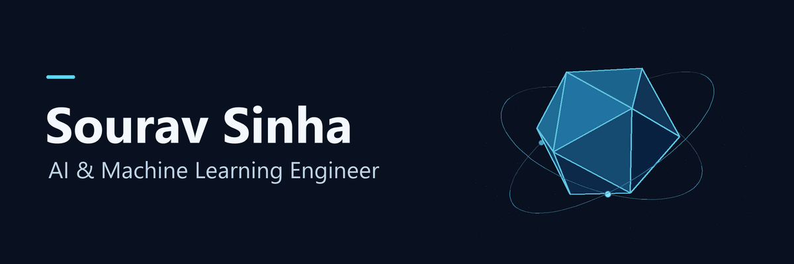

I build NLP, retrieval-augmented generation (RAG), and predictive ML applications. My work spans data preparation and model evaluation through APIs and deployment.

[LinkedIn](https://www.linkedin.com/in/sourav-s-211088216/)

## Featured projects

- **Company Knowledge Assistant** answers questions about company documents and returns source context. The FastAPI app uses PostgreSQL with pgvector for retrieval, Cohere for reranking, and RAGAS for evaluation. [View repository](https://github.com/Phoenixdelta74/Knowledge-Assistant)
- **Customer Churn Prediction** estimates bank customer churn with a TensorFlow/Keras model and a Streamlit interface for exploring predictions. [View repository](https://github.com/Phoenixdelta74/Churn-of-Customer)
- **SAURIK IT Website** includes interactive demos of an AI workflow with human review and a forecasting chart with confidence intervals. Built with React, Vite, and Tailwind CSS. [View repository](https://github.com/Phoenixdelta74/saurik_website)

## Technical focus

- **AI and machine learning** · Python, NLP, LLMs, RAG, PyTorch, TensorFlow
- **Applications and deployment** · FastAPI, Docker, Azure
- **Data and analytics** · SQL, PostgreSQL, Power BI, Tableau
