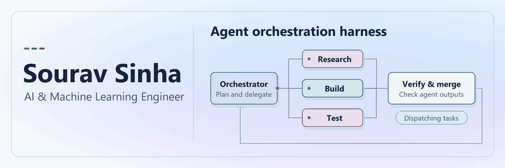

# I build AI workflows that check their work

I'm Sourav Sinha, an AI and machine learning engineer. I work on agent orchestration, retrieval-augmented generation (RAG), and evaluation, with a focus on checking the evidence behind a model's answer and deciding when to retry.

[LinkedIn](https://www.linkedin.com/in/sourav-s-211088216/)

## Featured build · Company Knowledge Assistant

A document Q&A app that returns answers with sources. Its LangGraph workflow routes questions to relevant document categories, retrieves and reranks excerpts, then checks whether the evidence supports an answer. If evidence is weak, it can rewrite the query and retry within a fixed limit.

- **Retrieval** · PostgreSQL/pgvector with Cohere reranking
- **Evaluation** · RAGAS with a reference question-and-answer set
- **Application** · FastAPI, a browser chat interface, and Docker Compose

[Source code](https://github.com/Phoenixdelta74/Knowledge-Assistant) · [Architecture and application flow](https://github.com/Phoenixdelta74/Knowledge-Assistant/blob/main/APP_FLOW.md)

## More projects

- **Customer Churn Prediction** · A TensorFlow/Keras model for bank customer churn with a Streamlit interface for exploring individual predictions. [Source code](https://github.com/Phoenixdelta74/Churn-of-Customer)
- **SAURIK IT Website** · A React site with demos of a human-reviewed AI workflow and a forecasting chart with confidence intervals. [Source code](https://github.com/Phoenixdelta74/saurik_website)
- **BMCAT Website** · A responsive community website with event filtering and a CSS-animated lotus. [Source code](https://github.com/Phoenixdelta74/BMCAT-Website)
